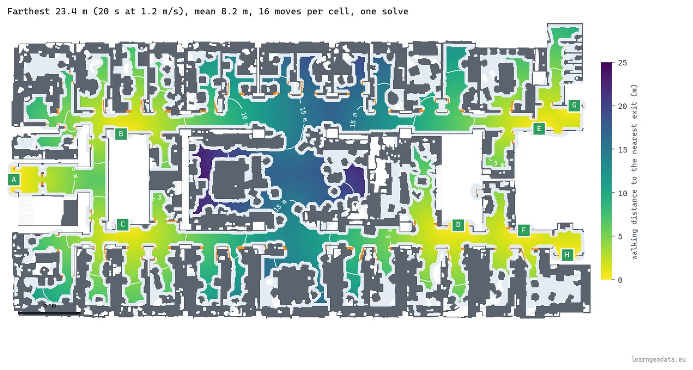
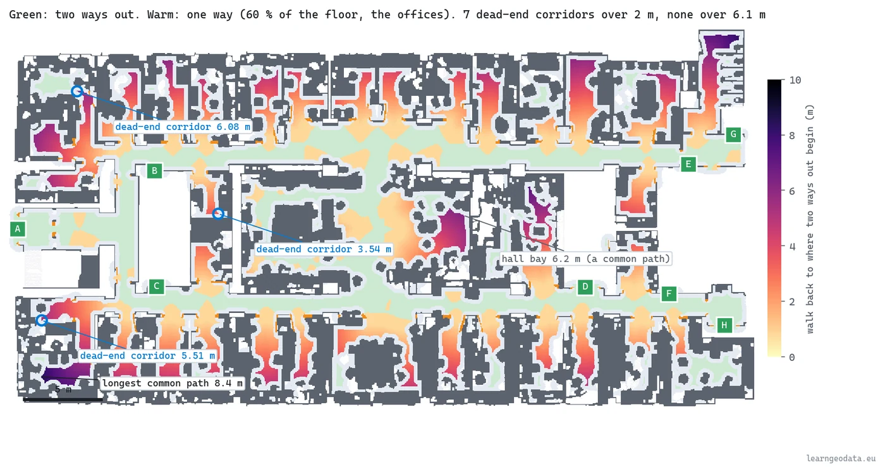
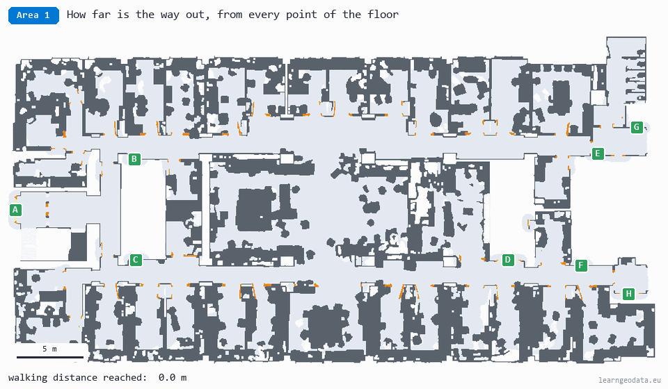
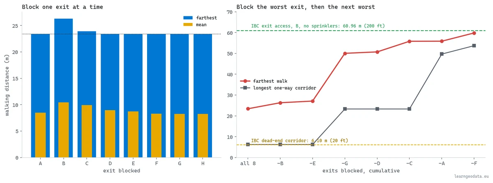

# Walking distance to the nearest exit, from a scan

One multi-source Dijkstra from the exits over a 16-neighbour grid, routes by descent, dead-end corridors from graph bridges, and a what-if for every blocked door. CPU only.



<sub>Yellow near an exit, purple far away, a contour every 5 m, 16 moves per cell. The farthest walkable cell is 23.41 m from its exit.</sub>

<p>
  <a href="https://learngeodata.eu/materials/evacuation-distance-map/"><strong>Get the reference output</strong></a> · <a href="https://medium.com/data-science-collective/how-to-build-a-2d-map-and-3d-evacuation-simulation-from-3d-scan-data-python-a4d7e71c0f0c">Read the article</a> · <a href="https://medium.com/@florentpoux">More tutorials</a>
  · <a href="https://learngeodata.eu/book/">The book</a>
</p>

---

## What it does

Reads the whole floor of S3DIS Area 1 (1,378,028 points at 5 cm), gives every point a role from its class, and builds a 5 cm walkable grid on a fixed lattice, with clearance measured to the obstacle's edge and each door opened at its leaf only. Eight declared exits, each the door leaf under its click, become the sources of one multi-source Dijkstra on a 16-neighbour walking graph, so every cell learns its walk to the nearest way out. Descending that field gives the escape route from any clicked point; each space is routed from its farthest point; one-way floor is split into common paths inside rooms and dead-end corridors in circulation; and every exit is blocked in turn, then worst first, with the whole floor re-solved each time. On Area 1 the farthest walk is **23.41 m (19.5 s)**, the mean 8.24 m, **33 spaces are routed**, no dead-end corridor passes 6.10 m, and with exit B already out, losing E and then G takes the farthest walk from 27.1 m to 50.0 m. Twenty-two pytest checks ship with it. The run takes **37 to 53 seconds on a CPU**, 36 what-if solves included. S3DIS cannot be redistributed, so the kit carries `prepare_s3dis.py`, which rebuilds this floor from your own download.



<sub>Two-way floor pale green, one-way floor coloured by its walk back: 7 dead-end corridors over 2 m, the longest 6.08 m, and a longest common path of 8.4 m.</sub>


## Get the data

This kit does not ship the scan, because its terms forbid passing it on. Get it
from the official page: **[S3DIS, the Stanford Large-Scale 3D Indoor Spaces dataset](http://buildingparser.stanford.edu/dataset.html)**.

1. On that page, follow the download link and fill in the dataset's
   [registration form](https://docs.google.com/forms/d/e/1FAIpQLScDimvNMCGhy_rmBA2gHfDu3naktRm6A8BPwAWWDv-Uhm6Shw/viewform).
2. From the confirmation page, download `Stanford3dDataset_v1.2_Aligned_Version.zip` and unzip it anywhere.
3. From this folder, run `python prepare_s3dis.py --s3dis "path/to/Stanford3dDataset_v1.2_Aligned_Version"`.


| File | What |
|---|---|
| `Stanford3dDataset_v1.2_Aligned_Version/Area_1/*/Annotations/*.txt` | Read. Every room of Area 1, one text file per object, named after its class. Only Area_1 is needed. |
| `data/s3dis_area1_open_5cm.ply` | Written next to the scripts. The whole Area 1 floor at 5 cm, 1,378,028 points. |
| `data/classes.json` | Written beside it. The class names of that file. |


prepare_s3dis.py reads the whole of Area 1, leaves out the ceiling and the beams, thins it to one point per 5 cm voxel and writes the copy the article ran on, 1,378,028 points, into a data/ folder next to the scripts, where evacuation_distance.py looks for it. Nothing else from S3DIS is needed.

**The numbers in the article come from S3DIS. Run the kit on your own scan and you get your own numbers.**

Terms: Stanford's registration form: "I will not redistribute the dataset in any way and in any format. Any new access will be established through this form and/or authors' official method of releasing the dataset. I agree that the data and derivatives will be used only for non-commercial research and academic purposes."

## Run it

```bash
pip install -r requirements.txt
python prepare_s3dis.py --s3dis "path/to/Stanford3dDataset_v1.2_Aligned_Version"
python evacuation_distance.py      # 37 to 53 s, writes out/metrics.json and the routes
python -m pytest tests -q          # 22 tests, about 17 s (the 3 on the real floor need data/)
python visualize.py                # one Open3D window per step
```

The floor comes from Stanford, not from this kit: S3DIS's terms rule out passing
it on. Get the dataset from the [official S3DIS page](http://buildingparser.stanford.edu/dataset.html)
as described in "Get the data" above. `prepare_s3dis.py` reads Area 1 (a few minutes, about 4 GB of RAM),
puts it on the 4 cm grid the article's copy used, leaves out the ceiling and the
beams, thins it to one point per 5 cm voxel (seed 0) and writes
`data/s3dis_area1_open_5cm.ply` with `data/classes.json`.

The eight exits are coordinates in the `EXITS` block of `evacuation_distance.py`,
in Area 1's own frame. If your floor plots somewhere else, move them. On Windows,
`run.bat` runs the pipeline and the replay on a double-click; `HEADLESS=1` builds
the replay without a window.

Requires Python 3.10, numpy, scipy, scikit-image, networkx, pytest for the tests, plyfile and pandas to rebuild the scan, and open3d with matplotlib for the 3D replay.

## How the reference output was made

The reference files come from the article's run on 2026-09-30, on a CPU: 1,378,028
points, a 16-neighbour field over 118,418 walkable cells, farthest walk 23.41 m,
mean 8.24 m, 33 spaces routed, 7 dead-end corridors over 2 m (the longest 6.08 m),
36 what-if solves, 53 seconds on a machine running other jobs.

The article's floor came from a 2020 conversion of S3DIS to LAS. Fed that file's
points in their order, `prepare_s3dis.py` rebuilds it bit for bit.
`tests/test_determinism.py` checks the pipeline on that floor: shuffled points and
a second run give identical numbers, and nudging every coordinate by up to 0.5 mm
moves the walkable floor from 296.05 to 296.36 m2 and the mean walk from 8.238 to
8.239 m, with the farthest walk unchanged. Stanford's own archive was not on hand,
so a rebuild from its text files was not rerun for this edition.

A fresh copy of this folder, given the article's own copy of the floor in `data/`,
reproduced `metrics.json` and `evacuation_routes.json` number for number, timings
aside (33 seconds that time), and passed all 22 tests.


## The result



<sub>Walking distance spreads from the eight exits until the floor is filled, then a red escape route grows from every room to its nearest exit.</sub>



<sub>Block one exit at a time, then worst first: the farthest walk jumps from 27.1 m to 50.0 m when G follows E.</sub>


## What is in the kit

| File | Where | What |
|---|---|---|
| `evacuation_distance.py` | here | The ten steps, from roles and the walkable grid to the what-if sweep and the export. |
| `prepare_s3dis.py` | here | Rebuilds the article's 5 cm Area 1 floor from your own S3DIS download. |
| `visualize.py` | here | The stepped 3D replay, one Open3D window per step. |
| `tests/conftest.py` | here | Shared test helpers, synthetic floors with answers known in advance. |
| `tests/test_geometry.py` | here | The walkable grid, known widths in and known widths out. |
| `tests/test_field.py` | here | The distance field, the routes and the what-if on grids whose answers are known. |
| `tests/test_dead_ends.py` | here | Dead-end corridors and common paths on a floor drawn by hand. |
| `tests/test_determinism.py` | here | On the real floor, shuffled, rerun and nudged by 0.5 mm; skipped until data/ holds it. |
| `run.bat` | here | Windows double-click runner, pipeline then replay. |
| `metrics.json` | [kit page](https://learngeodata.eu/materials/evacuation-distance-map/) | Every number the article quotes, from the grid to the what-if cascade. |
| `evacuation_routes.json` | [kit page](https://learngeodata.eu/materials/evacuation-distance-map/) | The exits, the route of every space and the dead-end corridors, in Area 1's metres. |

The reference output is served from the kit page rather than committed
here. The scan itself is not redistributed at all: see "Get the data" above.

## Go deeper

This is one pipeline. [3D Data Science with Python](https://learngeodata.eu/book/) is the discipline
underneath it: 690 pages from the Python foundations through point
cloud processing, meshing and the engineering that keeps a 3D workflow standing
up in production. Published by O'Reilly Media in 2025.

New to this? [The free 3D mission](https://learngeodata.eu/free-mission/) builds the point
cloud foundations this script leans on, in Python, at no cost.

## License

Code: MIT, see [LICENSE](../LICENSE). The reference output is distributed from
the kit page under its own terms, listed in [DATA_LICENSE.md](../DATA_LICENSE.md), and
is not covered by this repository's license. The scan stays under the terms of
S3DIS, the Stanford Large-Scale 3D Indoor Spaces dataset.

Data attribution: Reference outputs computed by Florent Poux from S3DIS, Area 1: I. Armeni, O. Sener, A. R. Zamir, H. Jiang, I. Brilakis, M. Fischer, S. Savarese, 3D Semantic Parsing of Large-Scale Indoor Spaces, CVPR 2016.

## Author

**Dr. Florent Poux**, Founder and Lead Instructor at the 3D Geodata Academy.
[learngeodata.eu](https://learngeodata.eu) · [ORCID 0000-0001-6368-4399](https://orcid.org/0000-0001-6368-4399) · [Medium](https://medium.com/@florentpoux)
