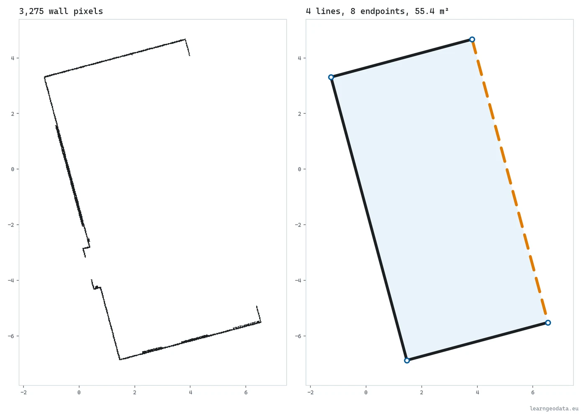
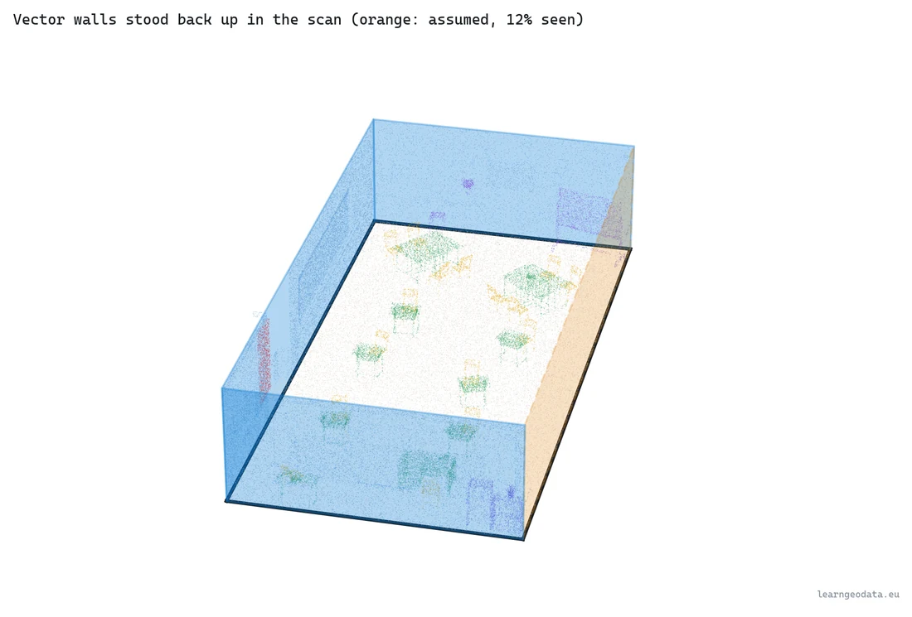
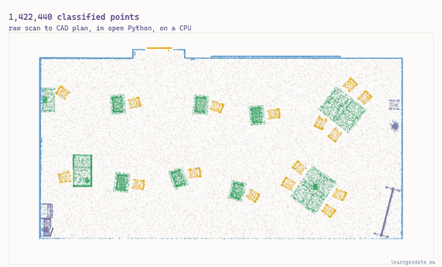
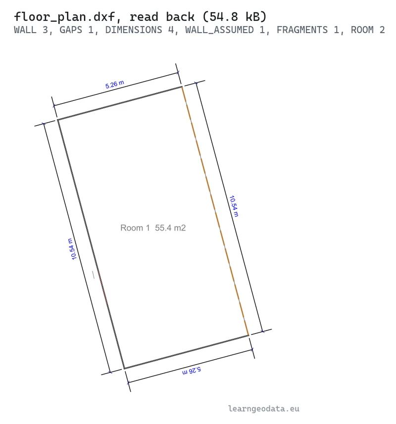

# Scan to floor plan, from wall pixels to a DXF

Turn the wall points of a classified room scan into clean vector walls and a layered DXF any CAD tool opens. CPU only.



<sub>Left, 3,275 wall pixels. Right, four lines with eight endpoints and a 55.42 m2 room: the jump this script makes.</sub>

<p>
  <a href="https://learngeodata.eu/materials/scan-to-floor-plan-dxf/"><strong>Get the dataset</strong></a> · <a href="https://medium.com/data-science-collective/how-to-turn-a-3d-scan-into-a-cad-floor-plan-f38562744833">Read the article</a> · <a href="https://medium.com/@florentpoux">More tutorials</a>
  · <a href="https://learngeodata.eu/book/">The book</a>
</p>

---

## What it does

Reads a classified classroom scan (1,422,440 points), levels it on a plane fitted to every floor point, keeps the band of wall points between floor and ceiling and rasterizes it on a 2 cm grid. Then it does the part a "generate plan" button hides: morphological closing, a one-cell skeleton, the skeleton traced into ordered chains, each chain split into straight runs fitted by total least squares, collinear pieces merged, walls squared to the room axis, snapped onto the median of their raw points and joined at the corners. It measures every wall's length, the share of it the scan saw and the support at its base, explains each unseen stretch, and writes `floor_plan.dxf` on six layers (WALL, WALL_ASSUMED, GAPS, FRAGMENTS, ROOM, DIMENSIONS) with that evidence stored on every wall, then reads it back to prove it opens. On the classroom, **eight runs merge into four walls** of 10.544 and 5.256 m and a **55.42 m2 room**; the fourth wall is drawn dashed because the band saw 12 % of it, even though its floor strip runs its whole length. Seventeen pytest checks on synthetic rooms with known answers ship with it. **About 0.4 seconds on a CPU.**



<sub>The walls stood back up in the scan. The orange one stands where the band saw 12 % of a wall and the floor strip saw all of it, so the DXF puts it on WALL_ASSUMED.</sub>


## Run it

```bash
pip install -r requirements.txt
python walls_to_vectors.py     # about 0.4 s, writes out/floor_plan.dxf and out/metrics.json
python -m pytest tests -q      # 17 tests on synthetic rooms with known answers
python visualize.py            # one Open3D window per stage, close it to move on
python sweeps.py               # optional: the parameter sweeps and stability runs quoted in the article
```

Download `classroom_scene.ply` from the [kit page](https://learngeodata.eu/materials/scan-to-floor-plan-dxf/)
and put it in a `data/` folder next to the scripts. The tests need no download:
every room they check is generated with a known answer. On Windows, `run.bat` runs
the pipeline and the replay on a double-click once Miniconda's `learning_env`
exists. Open `out/floor_plan.dxf` in QCAD, LibreCAD, AutoCAD or BricsCAD.

On your own scan: set `SCAN_FILE` and the three class ids (`WALL_CLASS`,
`FLOOR_CLASS`, `CEILING_CLASS`) at the top of `walls_to_vectors.py`.

Requires Python 3.10, numpy, scipy, scikit-image, shapely, ezdxf, pytest for the tests, and open3d for the 3D replay.

## How the reference output was made

`floor_plan.dxf` and `metrics.json` come from the article's run on 2026-09-30,
with numpy, scipy, scikit-image 0.25.2, shapely and ezdxf 1.4.3 on a laptop CPU:
1,422,440 points in, 3,275 wall cells, 8 straight runs merged into 4 walls of
10.544, 10.544, 5.256 and 5.256 m, a 55.42 m2 room with a 31.60 m perimeter, a
25 ms read and 297 ms of pipeline (timings vary with the machine). The DXF is 54.8 kB, in metres, with the seen and
base shares stored on each of its four walls. Every number the article quotes is in
`metrics.json`, step by step.

The same scan rerun, shuffled or moved by 1 cm gives identical numbers. A fresh
copy of this folder with the scan in `data/` reproduced `metrics.json` number for
number, timings aside, and passed all 17 tests; its DXF differs from mine only in
the date stamps and ids ezdxf writes into the header.


## The result



<sub>From 1,422,440 classified points to four walls, one room of 55.42 m2 and a layered DXF. The dashed orange wall is the one the scan barely saw, and the file says so.</sub>



<sub>floor_plan.dxf read back from disk, 54.8 kB: walls, the assumed wall, the gap, four dimensions and the room.</sub>


## What is in the kit

| File | Where | What |
|---|---|---|
| `walls_to_vectors.py` | here | The nine steps, from the wall-evidence grid to a DXF read back from disk. |
| `visualize.py` | here | The stepped 3D replay, one Open3D window per stage. |
| `sweeps.py` | here | The split, closing and merge sweeps, and the stability runs (rerun, shuffled, moved, rounded, rotated). |
| `tests/test_walls_to_vectors.py` | here | Seventeen pytest checks on synthetic rooms with known answers (python -m pytest tests -q). |
| `run.bat` | here | Windows double-click runner, pipeline then replay. |
| `classroom_scene.ply` | [kit page](https://learngeodata.eu/materials/scan-to-floor-plan-dxf/) | The classified classroom, 1,422,440 points with colour and a scalar_semantic_label field, 27 MB. |
| `floor_plan.dxf` | [kit page](https://learngeodata.eu/materials/scan-to-floor-plan-dxf/) | The drawing in metres, six layers, evidence on every wall, the file your run should reproduce. 55 kB. |
| `metrics.json` | [kit page](https://learngeodata.eu/materials/scan-to-floor-plan-dxf/) | Every number the article quotes, step by step. |

The datasets are served from the kit page rather than committed here, because a
20 MB point cloud does not belong in git history.

## Go deeper

This is one pipeline. [3D Data Science with Python](https://learngeodata.eu/book/) is the discipline
underneath it: 690 pages from the Python foundations through point
cloud processing, meshing and the engineering that keeps a 3D workflow standing
up in production. Published by O'Reilly Media in 2025.

New to this? [The free 3D mission](https://learngeodata.eu/free-mission/) builds the point
cloud foundations this script leans on, in Python, at no cost.

## License

Code: MIT, see [LICENSE](../LICENSE). The dataset is distributed from the kit
page under its own terms, listed in [DATA_LICENSE.md](../DATA_LICENSE.md), and is
not covered by this repository's license.

Data attribution: The classroom scan is the example scene that ships with Neurones 3D, classified into seven classes (created in CloudCompare, November 2025).

## Author

**Dr. Florent Poux**, Founder and Lead Instructor at the 3D Geodata Academy.
[learngeodata.eu](https://learngeodata.eu) · [ORCID 0000-0001-6368-4399](https://orcid.org/0000-0001-6368-4399) · [Medium](https://medium.com/@florentpoux)
