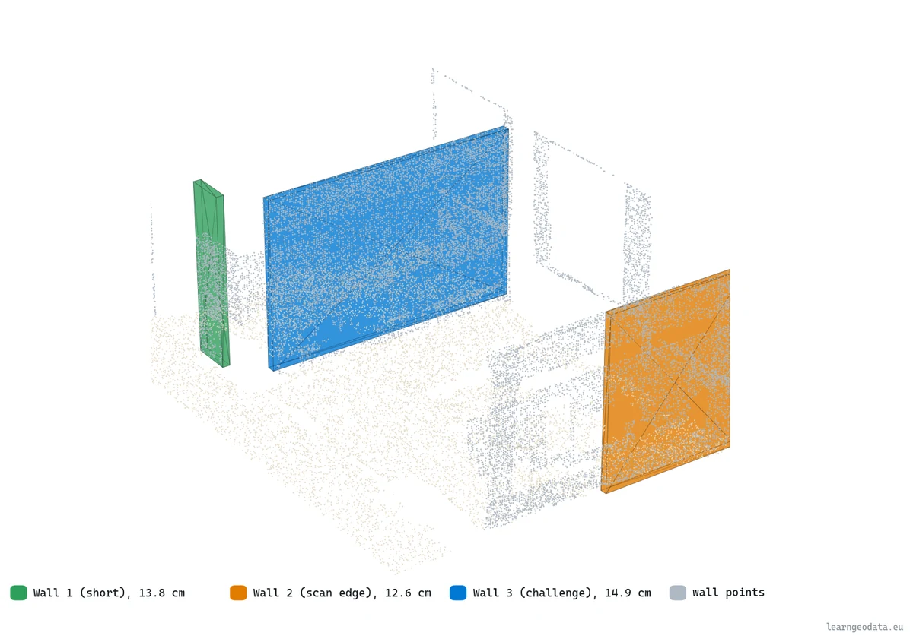
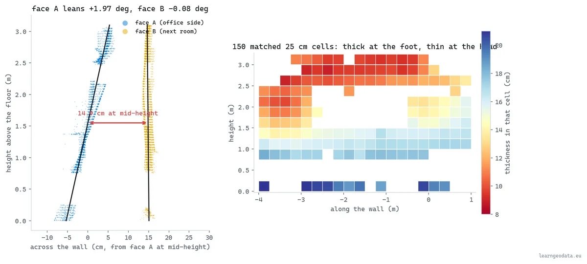
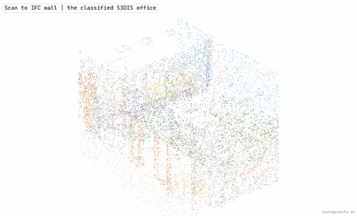
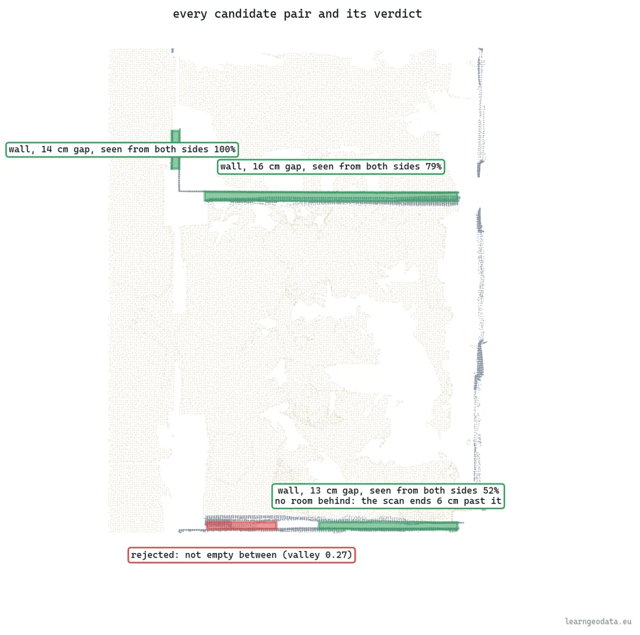

# Wall thickness from a scan, written to IFC

Find the two faces of a wall as density peaks, pair them, measure the gap cell by cell, write an IfcWall and prove it. CPU only.



<sub>The three IfcWall solids, read back from the written file, standing among the points they were measured from: 13.78, 12.59 and 14.87 cm.</sub>

<p>
  <a href="https://learngeodata.eu/materials/wall-thickness-to-ifc/"><strong>Get the reference output</strong></a> · <a href="https://medium.com/data-science-collective/3d-scan-to-bim-101-hands-on-automation-course-92f9e45acd7d">Read the article</a> · <a href="https://medium.com/@florentpoux">More tutorials</a>
  · <a href="https://learngeodata.eu/book/">The book</a>
</p>

---

## What it does

Levels a classified office scan on the bisector of its floor and ceiling planes, finds the two wall directions from the normals, and projects the wall points onto each normal so every face becomes a peak in a 1D density profile. Faces are cut into runs and paired, and each pair has to pass four tests (how far apart, over what length, empty between, seen from both sides) before it counts as a wall. The thickness is then read only where both faces were scanned at the same place and height, as the distance between the two face lines at mid-storey, with a bootstrap interval over those matched cells. On the S3DIS office, 9 faces give **three walls, 13.78, 12.59 and 14.87 cm**, the last with one face leaning about 2 degrees. They are written as IFC4 walls with ifcopenshell, then the file is reopened and checked against the schema, its own geometry and the points. Seventeen pytest checks on synthetic walls of known thickness ship with it. **About 1.3 seconds on a CPU.** S3DIS cannot be redistributed, so the kit carries `prepare_s3dis.py`, which rebuilds the article's office from your own download.



<sub>Left, the challenge wall edge-on: one face leans, one stands, 14.87 cm at mid-height. Right, all 150 matched cells, each coloured by the thickness measured in it.</sub>


## Get the data

This kit does not ship the scan, because its terms forbid passing it on. Get it
from the official page: **[S3DIS, the Stanford Large-Scale 3D Indoor Spaces dataset](http://buildingparser.stanford.edu/dataset.html)**.

1. On that page, follow the download link and fill in the dataset's
   [registration form](https://docs.google.com/forms/d/e/1FAIpQLScDimvNMCGhy_rmBA2gHfDu3naktRm6A8BPwAWWDv-Uhm6Shw/viewform).
2. From the confirmation page, download `Stanford3dDataset_v1.2_Aligned_Version.zip` and unzip it anywhere.
3. From this folder, run `python prepare_s3dis.py --s3dis "path/to/Stanford3dDataset_v1.2_Aligned_Version"`.


| File | What |
|---|---|
| `Stanford3dDataset_v1.2_Aligned_Version/Area_1/*/Annotations/*.txt` | Read. Every room of Area 1, one text file per object, named after its class. Only Area_1 is needed. |
| `data/s3dis_office.ply` | Written next to the scripts. The office the article measured, 191,353 points. |
| `data/s3dis_office.ply.n3d.json` | Written beside it. The class names of that file. |


prepare_s3dis.py reads the whole of Area 1, puts it on the same 4 cm grid the article's copy used, cuts out the office at the east edge of the area and writes the 191,353 points the article measured into a data/ folder next to the scripts, where wall_thickness_to_ifc.py looks for them. Nothing else from S3DIS is needed.

**The numbers in the article come from S3DIS. Run the kit on your own scan and you get your own numbers.**

Terms: Stanford's registration form: "I will not redistribute the dataset in any way and in any format. Any new access will be established through this form and/or authors' official method of releasing the dataset. I agree that the data and derivatives will be used only for non-commercial research and academic purposes."

## Run it

```bash
pip install -r requirements.txt
python prepare_s3dis.py --s3dis "path/to/Stanford3dDataset_v1.2_Aligned_Version"
python wall_thickness_to_ifc.py   # about 1.3 s, writes out/measured_partitions.ifc and out/metrics.json
python -m pytest tests -q         # 17 synthetic walls with known answers, about 10 s
python check_determinism.py       # optional: reruns, shuffles and rounding, writes out/robustness.json
python visualize.py               # one Open3D window per step
```

Step one is yours, because S3DIS's terms rule out passing it on: get the
dataset from the [official S3DIS page](http://buildingparser.stanford.edu/dataset.html)
as described in "Get the data" above. `prepare_s3dis.py` reads Area 1 (a few
minutes, about 4 GB of RAM) and prints the point count and a fingerprint next to
the article's, so you know how close your input is. The tests need no download:
they build their own walls of known thickness.

If `pip install ifcopenshell` finds no wheel for your Python, use
`conda install -c conda-forge ifcopenshell`. On Windows, `run.bat` runs the
pipeline and the replay on a double-click once `data/` is filled.

Requires Python 3.10, numpy, scipy, ifcopenshell, pytest for the tests, pandas and plyfile to rebuild the scan, and open3d for the 3D replay.

## How the reference output was made

The reference files come from the article's run on 2026-09-30, on a CPU with
ifcopenshell 0.8.4.post1: 191,353 points, 9 faces, three walls at 13.78, 12.59 and
14.87 cm at mid-height, 166 IFC entities, zero schema errors, 1.25 seconds.

The article's office came from a 2020 conversion of S3DIS to LAS. Fed that file's
points in their order, `prepare_s3dis.py` rebuilds it bit for bit.
`check_determinism.py` puts the measurement through what a different copy can
change: run again and shuffled three ways, no thickness moves; with every
coordinate rounded to 1 mm, the largest change is 0.0006 cm. The IFC file's bytes
can differ from run to run (ifcopenshell writes its unit set in no fixed order);
its GlobalIds do not. Stanford's own archive was not on hand, so a rebuild from
its text files was not rerun for this edition.

A fresh copy of this folder, given the article's own copy of the office in
`data/`, reproduced `metrics.json` and `result.json` number for number, timings
aside, passed all 17 tests, and `check_determinism.py` printed the same table.


## The result



<sub>From the classified office to three IFC4 walls: the faces the scanner saw on each side light up, then each wall rises with the thickness measured between them.</sub>



<sub>Three walls accepted (green), one pair rejected because something fills the gap (red). The south wall is flagged: the scan ends 6 cm behind it, so no room shows there, but both of its faces were seen.</sub>


## What is in the kit

| File | Where | What |
|---|---|---|
| `wall_thickness_to_ifc.py` | here | Level, find the faces, pair them, measure cell by cell, write the IfcWall and prove it. |
| `prepare_s3dis.py` | here | Rebuilds the article's office from your own S3DIS download (Area 1, 4 cm grid). |
| `visualize.py` | here | The stepped 3D replay, one Open3D window per step. |
| `check_determinism.py` | here | The thicknesses again, rerun, shuffled, rounded to 1 mm and with other normal neighbourhoods; writes out/robustness.json. |
| `tests/test_wall_thickness.py` | here | Seventeen pytest checks on synthetic walls of known thickness (python -m pytest tests -q). |
| `tests/synth.py` | here | The synthetic scans the tests measure, two rooms and a partition of known thickness. |
| `run.bat` | here | Windows double-click runner, pipeline then replay. |
| `measured_partitions.ifc` | [kit page](https://learngeodata.eu/materials/wall-thickness-to-ifc/) | The three walls as IFC4 walls with their measured thickness, 166 entities, schema-valid. 11 kB. |
| `result.json` | [kit page](https://learngeodata.eu/materials/wall-thickness-to-ifc/) | Every face, pair, thickness and check the article quotes, including the density profiles. |

The reference output is served from the kit page rather than committed
here. The scan itself is not redistributed at all: see "Get the data" above.

## Go deeper

This is one pipeline. [3D Data Science with Python](https://learngeodata.eu/book/) is the discipline
underneath it: 690 pages from the Python foundations through point
cloud processing, meshing and the engineering that keeps a 3D workflow standing
up in production. Published by O'Reilly Media in 2025.

New to this? [The free 3D mission](https://learngeodata.eu/free-mission/) builds the point
cloud foundations this script leans on, in Python, at no cost.

## License

Code: MIT, see [LICENSE](../LICENSE). The reference output is distributed from
the kit page under its own terms, listed in [DATA_LICENSE.md](../DATA_LICENSE.md), and
is not covered by this repository's license. The scan stays under the terms of
S3DIS, the Stanford Large-Scale 3D Indoor Spaces dataset.

Data attribution: Reference outputs computed by Florent Poux from S3DIS, Area 1: I. Armeni, O. Sener, A. R. Zamir, H. Jiang, I. Brilakis, M. Fischer, S. Savarese, 3D Semantic Parsing of Large-Scale Indoor Spaces, CVPR 2016.

## Author

**Dr. Florent Poux**, Founder and Lead Instructor at the 3D Geodata Academy.
[learngeodata.eu](https://learngeodata.eu) · [ORCID 0000-0001-6368-4399](https://orcid.org/0000-0001-6368-4399) · [Medium](https://medium.com/@florentpoux)
