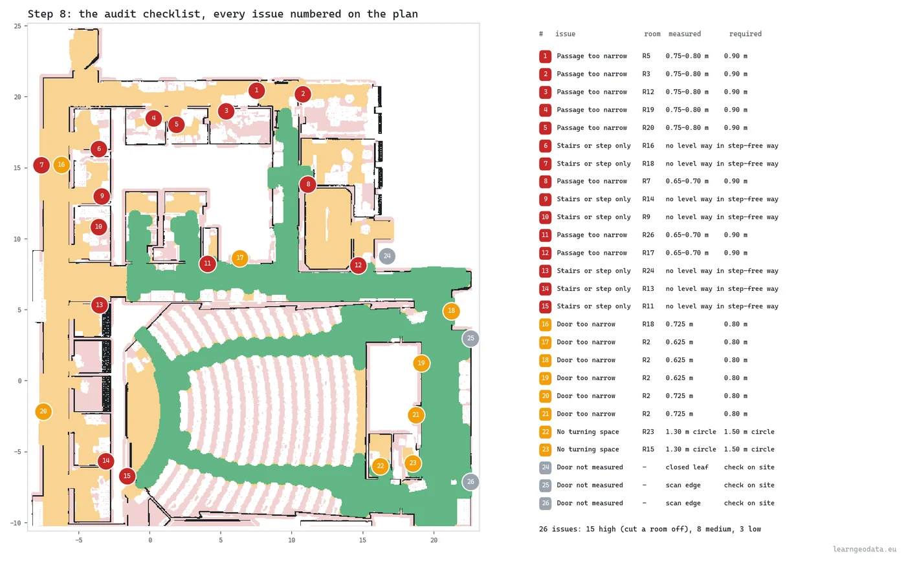
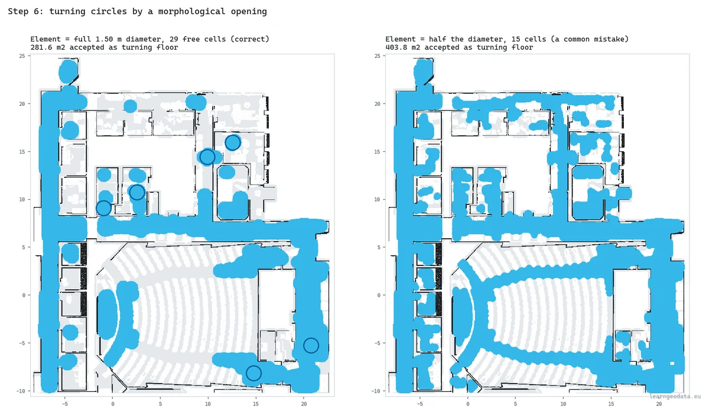
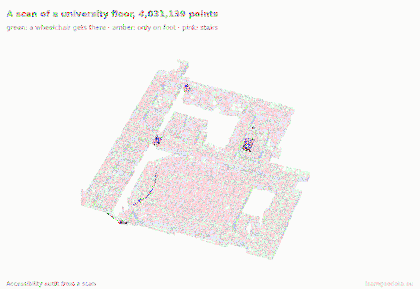
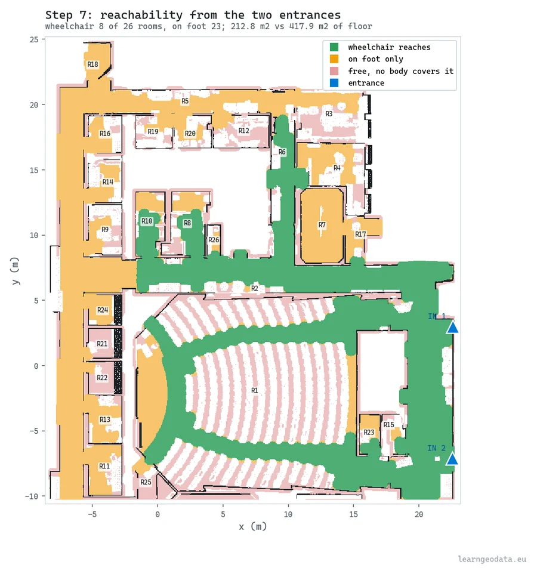

# Wheelchair accessibility audit from a 3D scan

Clear width by distance transform, turning space by morphological opening, reach by connected components, then a numbered issue list. CPU only.



<sub>Every issue numbered on the plan, with its room, measured value and required value. Red cuts a room off, amber fails the profile, grey needs a site check.</sub>

<p>
  <a href="https://learngeodata.eu/materials/wheelchair-accessibility-audit/"><strong>Get the reference output</strong></a> · <a href="https://medium.com/data-science-collective/how-to-automate-3d-deliverables-accessibility-map-from-3d-scan-3ecef96a5a6f">Read the article</a> · <a href="https://medium.com/@florentpoux">More tutorials</a>
  · <a href="https://learngeodata.eu/book/">The book</a>
</p>

---

## What it does

Turns a classified floor scan into the checklist a facilities manager can act on. The floor becomes a walkable grid on a fixed lattice; one distance transform, read face to face, gives the clear width everywhere; the floor shrinks to where a wheelchair's centre can stand; every door is measured on a 2.5 cm grid of its own jambs against the required width; a morphological opening with a 1.50 m element finds the floor you can turn on; rooms are sealed at gaps narrower than a walker, and connected components from the two entrances say which rooms a wheelchair reaches and which only a walker does. On 4,031,139 points of S3DIS Area 2 it measures 38 doors and 26 rooms, reaches **8 of 26 rooms by wheelchair against 23 on foot**, numbers **26 issues** (15 high) on the plan, and shows that one ramp takes the count from 8 to 16. Forty-six known-answer tests ship with it, and the same numbers come back when the scan is read again, shuffled or rounded to the millimetre. **Under 4 seconds on a CPU.** S3DIS cannot be redistributed, so the kit carries `prepare_s3dis.py`, which rebuilds this part of Area 2 from your own download, the same file whatever order your copy is read in.



<sub>The opening with the full 1.50 m element keeps 281.6 m2 of turning floor. Half of it, a common mistake, accepts 403.8 m2, 43 % more.</sub>


## Get the data

This kit does not ship the scan, because its terms forbid passing it on. Get it
from the official page: **[S3DIS, the Stanford Large-Scale 3D Indoor Spaces dataset](http://buildingparser.stanford.edu/dataset.html)**.

1. On that page, follow the download link and fill in the dataset's
   [registration form](https://docs.google.com/forms/d/e/1FAIpQLScDimvNMCGhy_rmBA2gHfDu3naktRm6A8BPwAWWDv-Uhm6Shw/viewform).
2. From the confirmation page, download `Stanford3dDataset_v1.2_Aligned_Version.zip` and unzip it anywhere.
3. From this folder, run `python prepare_s3dis.py --s3dis "path/to/Stanford3dDataset_v1.2_Aligned_Version"`.


| File | What |
|---|---|
| `Stanford3dDataset_v1.2_Aligned_Version/Area_2/*/Annotations/*.txt` | Read. Every room of Area 2, one text file per object, named after its class (the stairs files included). Only Area_2 is needed. |
| `data/s3dis_area2_access.ply` | Written next to the scripts. The north half of Area 2 the audit ran on, 4,031,139 points, fingerprint 6cfc4bc8...41181. |


prepare_s3dis.py reads Area 2 with its stairs, keeps the north half without the ceiling, and writes the 4,031,139 points the audit ran on into a data/ folder next to the scripts, where accessibility_audit.py looks for them. It keeps one point per voxel by a rule that ignores read order, so your rebuild matches the article's whatever order your copy is read in, and it prints a fingerprint to prove it. Nothing else from S3DIS is needed.

**The numbers in the article come from S3DIS. Run the kit on your own scan and you get your own numbers.**

Terms: Stanford's registration form: "I will not redistribute the dataset in any way and in any format. Any new access will be established through this form and/or authors' official method of releasing the dataset. I agree that the data and derivatives will be used only for non-commercial research and academic purposes."

## Run it

```bash
pip install -r requirements.txt
python prepare_s3dis.py --s3dis "path/to/Stanford3dDataset_v1.2_Aligned_Version"
python accessibility_audit.py      # about 4 s, writes out/issues.csv and out/metrics.json
python -m pytest tests -q          # 46 known-answer tests, about 2 s
python check_stability.py          # optional: again, shuffled, rounded: the same numbers?
python visualize.py                # one 3D window per step
```

S3DIS's terms rule out passing it on, so the scan is the one thing you fetch
yourself, from the [official S3DIS page](http://buildingparser.stanford.edu/dataset.html)
as described in "Get the data" above. `prepare_s3dis.py` reads Area 2 with its
stairs (a few minutes, about 4 GB of RAM), keeps its north half without the
ceiling, the floor and the stairs at 2 cm and the rest at 3 cm, and writes
`data/s3dis_area2_access.ply`.

The point it keeps in each voxel does not depend on the order your files are read
in (the majority class, then the point nearest that class's centroid), so any copy
of Stanford's files gives the same scan. It prints a fingerprint; the article's is
`6cfc4bc8f6ce1f1c97d5f52a20177725a7686601bac58edff21a83bbbcd41181`, and the audit
writes the fingerprint of what it read into `out/metrics.json`.

On Windows, `run.bat` runs the audit and the replay on a double-click once
`data/` is filled. No screen? `VIZ_SMOKE=1` builds every step without a window.

Requires Python 3.10, numpy, scipy, pytest for the tests, pandas and plyfile to rebuild the scan, and open3d with matplotlib for the 3D replay.

## How the reference output was made

The reference files come from the article's run on 2026-09-30, on a CPU: 4,031,139
points, 38 doors, 26 rooms, 8 reached by wheelchair and 23 on foot, 26 issues (15
high), one ramp taking the count from 8 to 16, 3.7 seconds. `metrics.json` records
the input it read by its SHA-256,
`6cfc4bc8f6ce1f1c97d5f52a20177725a7686601bac58edff21a83bbbcd41181`.

That input is the order-free rebuild. The article's first edition kept the first
point read in each voxel, and a rebuild read in another order moved rooms, reach and
door counts. `prepare_s3dis.py` now keeps the point of the majority class nearest
that class's centroid: rebuilt from the 2020 LAS conversion of S3DIS in its own
order and shuffled two ways, it wrote the same file bit for bit, and the audit found
26 rooms, 8 by wheelchair and 26 issues on seven rebuilds of the input, the
first-edition recipe included. `check_stability.py` repeats the check on your copy:
again, shuffled and rounded to the millimetre, all twelve headline numbers are
identical. Stanford's own text files were not on hand, so the rebuild from them was
not run end to end here; the thinning it calls is the one tested and used for the
article's file.

A fresh copy of this folder, given the article's own copy of the scan in `data/`,
reproduced `metrics.json`, `summary.json` and `issues.csv` exactly, timings aside,
passed all 46 tests, and `check_stability.py` found its four columns identical.


## The result



<sub>The audit in motion: wheelchair reach spreads green from the two entrances, walker reach amber, then the 26 numbered issues drop onto the scan.</sub>



<sub>Green: reached by wheelchair. Amber: on foot only. 8 of 26 rooms by wheelchair, 23 on foot.</sub>


## What is in the kit

| File | Where | What |
|---|---|---|
| `accessibility_audit.py` | here | The nine steps, from the walkable grid to the numbered issue list and the ramp. |
| `prepare_s3dis.py` | here | Rebuilds the article's part of Area 2 from your own S3DIS download, order-free, and prints its fingerprint. |
| `visualize.py` | here | The stepped 3D replay, one Open3D window per step. |
| `check_stability.py` | here | The audit four ways (as is, again, shuffled, rounded to 1 mm), twelve headline numbers side by side. |
| `tests/test_audit.py` | here | Forty-six known-answer tests on scans built point by point (python -m pytest tests -q). |
| `tests/run_tests.py` | here | Runs the tests from a script, for a double-click or a job runner. |
| `run.bat` | here | Windows double-click runner, audit then replay. |
| `issues.csv` | [kit page](https://learngeodata.eu/materials/wheelchair-accessibility-audit/) | The 26 numbered issues, with room, position, measured and required value. |
| `metrics.json` | [kit page](https://learngeodata.eu/materials/wheelchair-accessibility-audit/) | The headline numbers in one flat file, with the SHA-256 fingerprint of the scan the audit read. |
| `summary.json` | [kit page](https://learngeodata.eu/materials/wheelchair-accessibility-audit/) | Every number the audit printed, with the door list and the issue list. |

The reference output is served from the kit page rather than committed
here. The scan itself is not redistributed at all: see "Get the data" above.

## Go deeper

This is one pipeline. [3D Data Science with Python](https://learngeodata.eu/book/) is the discipline
underneath it: 690 pages from the Python foundations through point
cloud processing, meshing and the engineering that keeps a 3D workflow standing
up in production. Published by O'Reilly Media in 2025.

New to this? [The free 3D mission](https://learngeodata.eu/free-mission/) builds the point
cloud foundations this script leans on, in Python, at no cost.

## License

Code: MIT, see [LICENSE](../LICENSE). The reference output is distributed from
the kit page under its own terms, listed in [DATA_LICENSE.md](../DATA_LICENSE.md), and
is not covered by this repository's license. The scan stays under the terms of
S3DIS, the Stanford Large-Scale 3D Indoor Spaces dataset.

Data attribution: Reference outputs computed by Florent Poux from S3DIS, Area 2: I. Armeni, O. Sener, A. R. Zamir, H. Jiang, I. Brilakis, M. Fischer, S. Savarese, 3D Semantic Parsing of Large-Scale Indoor Spaces, CVPR 2016.

## Author

**Dr. Florent Poux**, Founder and Lead Instructor at the 3D Geodata Academy.
[learngeodata.eu](https://learngeodata.eu) · [ORCID 0000-0001-6368-4399](https://orcid.org/0000-0001-6368-4399) · [Medium](https://medium.com/@florentpoux)
